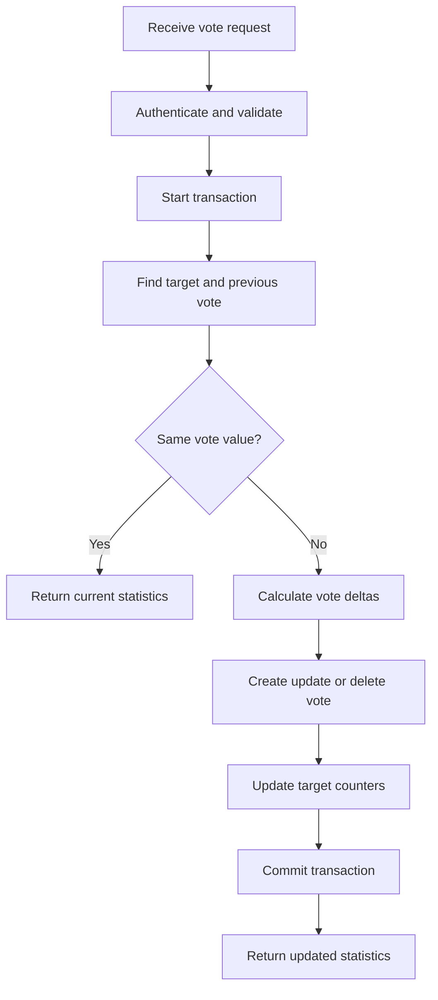

# Voting System Design

## 1. Overview

The voting system supports upvoting, downvoting,
switching votes, and removing votes on posts and comments.

The implementation maintains accurate voting statistics
and prevents duplicate votes during concurrent requests.

## 2. Implemented Features

- Post and comment voting.
- One vote per user per target.
- Vote switching and removal.
- Automatic score and counter updates.
- Concurrency-safe database transactions.
- Authenticated and validated voting endpoints.
- Retrieval of previous user votes.
- Reusable React voting components.
- Optimistic UI updates and error rollback.
- Dark mode and keyboard accessibility.

## 3. Implementation Files

### Backend

| File | Responsibility |
| --- | --- |
| models/Vote.js | Vote schema and database indexes |
| services/vote.service.js | Voting logic and transactions |
| controllers/voteController.js | Request and response handling |
| routes/voteRoutes.js | Voting API endpoints |
| routes/index.js | Route registration |
| middleware/attachUserVotes.js | User vote retrieval |
| tests/Vote.concurrency.test.js | Functional and concurrency tests |

### Frontend

| File | Responsibility |
| --- | --- |
| api/Votes.js | Shared API integration |
| components/VoteButtons.jsx | Interactive voting component |
| components/VoteButtons.css | Voting component styling |

## 4. Database Design

Votes are stored in a separate MongoDB collection.

Each vote contains:

- user: Reference to the voting user.
- targetType: Post or Comment.
- targetId: Reference to the voting target.
- value: 1 or -1.
- createdAt and updatedAt timestamps.

A unique compound index on user, targetType, and targetId
prevents duplicate votes.

A secondary index on targetType and targetId supports
target-based vote queries.

A vote value of 0 removes the existing vote document.

## 5. Voting Logic

| Value | Action |
| --- | --- |
| 1 | Upvote |
| -1 | Downvote |
| 0 | Remove vote |

Score = Upvote Count - Downvote Count

Score Change = New Vote - Previous Vote

| Previous Vote | New Vote | Score Change |
| --- | --- | --- |
| 0 | 1 | +1 |
| 0 | -1 | -1 |
| 1 | -1 | -2 |
| -1 | 1 | +2 |
| 1 | 0 | -1 |
| -1 | 0 | +1 |
| Same value | Same value | 0 |

Repeated identical API requests do not change the score.

## 6. Concurrency Strategy

The voting service uses:

- MongoDB sessions and transactions.
- Unique compound indexes.
- Atomic counter updates using $inc.
- Duplicate-key conflict retries.
- Automatic transaction retries.
- Database session cleanup.

The vote document and target statistics are updated
within the same transaction.

MongoDB must run as a replica set or a supported
sharded cluster.

### Voting Workflow



## 7. API Integration

| Method | Endpoint |
| --- | --- |
| PUT | /api/posts/:id/vote |
| PUT | /api/comments/:id/vote |

Both endpoints require authentication.

Example request:

```json
{
  "value": 1
}
```

Example successful response:

```json
{
  "success": true,
  "data": {
    "targetId": "507f1f77bcf86cd799439011",
    "targetType": "Post",
    "score": 10,
    "upvoteCount": 12,
    "downvoteCount": 2,
    "userVote": 1
  }
}
```

The shared API contract is maintained in
[openapi.yaml](./openapi.yaml).

Database schema documentation is maintained in
[schemas.md](./schemas.md).

## 8. Frontend Implementation

The reusable VoteButtons component supports posts
and comments.

It provides immediate optimistic updates, processes
voting requests sequentially, and restores the last
confirmed state when an API request fails.

The component uses the existing shared API client
rather than implementing separate authentication
or HTTP request logic.

## 9. Testing

The voting tests use the native Node.js Test Runner
and an isolated MongoDB replica set.

Run the voting tests from the server directory:

```bash
npm install
npm run test:voting
```

### Test Results

| ID | Test Scenario | Result |
| --- | --- | --- |
| T01 | 100 concurrent upvotes | PASS |
| T02 | 20 concurrent upvotes from one user | PASS |
| T03 | Vote switching and removal | PASS |
| T04 | 30 mixed concurrent votes from one user | PASS |
| T05 | 200 mixed concurrent votes from 20 users | PASS |
| T06 | Concurrent upvotes and downvotes | PASS |
| T07 | Concurrent comment voting | PASS |
| T08 | Independent post and comment votes | PASS |
| T09 | Invalid vote values | PASS |
| T10 | Nonexistent voting target | PASS |
| T11 | Previous user vote retrieval | PASS |
| T12 | Invalid target IDs | PASS |
| T13 | Guest vote lookup | PASS |

### Recorded Execution

- Total tests: 13
- Passed: 13
- Failed: 0
- Skipped: 0
- Execution time: approximately 19.9 seconds
- Success rate: 100%

All voting service tests passed successfully.

## 10. Individual Contribution

- Voting schema review.
- Transaction-based voting service.
- Concurrency and duplicate vote handling.
- Voting controllers and API routes.
- User vote retrieval helper.
- Frontend voting API wrapper.
- Reusable React voting component and styling.
- Functional and concurrency testing.
- Testing configuration.
- Voting system documentation.

## 11. Verification Status

Completed:

- Core voting implementation.
- Database consistency testing.
- All 13 voting service tests.

Pending final integration:

- Complete backend test suite.
- HTTP endpoint testing.
- Dedicated transaction rollback test.
- Frontend page integration and runtime testing.
- Shared API and schema documentation verification.
- Dependency security review.
